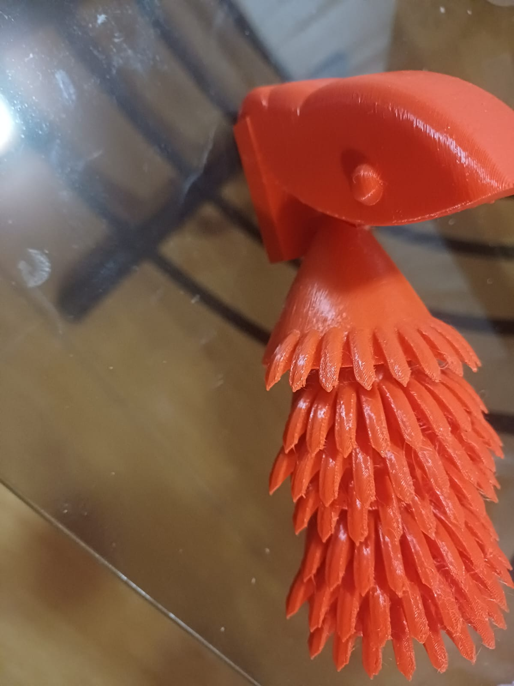

# Clase 7 — Impresión 3D: pieza articulada

En esta práctica trabajamos con impresión 3D. El objetivo era obtener una pieza con **uniones articuladas** que saliera de la impresora ya armada, sin ensamblarla después.

## 1. El modelo

Mi pieza es una figura articulada con segmentos en forma de púas. Los segmentos van unidos entre sí y se pueden mover.

| Dato | Valor |
|------|-------|
| Archivo | `profe_god_1.stl` |
| Medidas aproximadas | 130 × 63 × 68 mm |
| Número de triángulos | 22,571 |

En las piezas articuladas lo más importante es la **holgura** entre las partes móviles. Si el espacio es muy pequeño, la impresora fusiona las piezas y ya no se mueven. Si es muy grande, la unión queda floja.

## 2. Preparación para imprimir

1. Exportar el modelo como **STL**.
2. Abrirlo en el software laminador (**Bambu Studio**).
3. Orientar la pieza con su cara más plana sobre la cama, para que tenga buena adherencia.
4. Revisar en la vista previa de capas que las uniones no queden pegadas.
5. Agregar soportes solo donde haga falta, para no tener que limpiar de más.

## 3. Resultado

*Pieza impresa en filamento naranja. Se ven las uniones y los segmentos con púas.*

En la foto se nota que algunas puntas quedaron con hilitos de filamento, conocidos como *stringing*. Pasa cuando la boquilla gotea material al moverse entre una punta y otra. Se limpian fácilmente con unas pinzas o pasando aire caliente rápido.

## Aprendizajes

Aprendí que en la impresión 3D la orientación de la pieza y la holgura de las uniones importan tanto como el diseño. Con una pieza articulada bien diseñada no hace falta ensamblar nada: sale de la impresora lista para moverse.

## Archivo del proyecto

[🧊 Descargar modelo 3D (.STL)](archivos/profe_god_1.stl)
