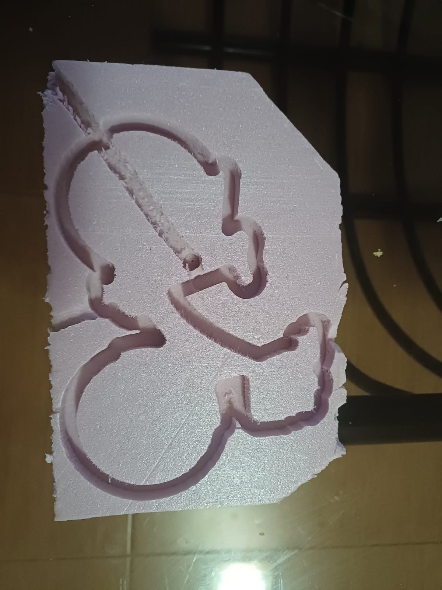
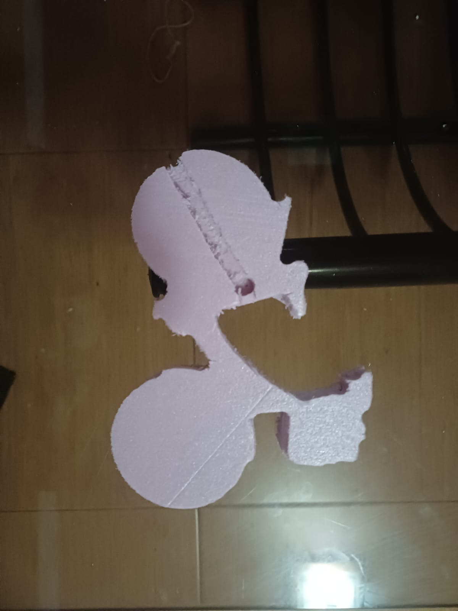

# Clase 8 — Máquina CNC: bicicleta en espuma

En esta práctica aprendimos el proceso completo para maquinar una pieza en CNC: del diseño al Código G y luego a la máquina. Mi pieza fue una **bicicleta** cortada en espuma rosa.

## 1. Del diseño al Código G con VCarve Pro

**VCarve Pro** es un software CAM. Recibe un dibujo vectorial (DXF o SVG) y lo convierte en las trayectorias que va a seguir la herramienta.

1. Importar el dibujo de la bicicleta.
2. Definir el material (*stock*): medidas de la placa y grosor.
3. Elegir la estrategia de corte:
   - **Perfilado (*Profile*):** corta siguiendo el contorno para sacar la pieza.
   - **Cajeado (*Pocket*):** vacía el material dentro de un área.
4. Guardar las trayectorias como **Código G**, que es un archivo de texto con las instrucciones para la máquina.

## 2. Revisión en NC Viewer

Antes de mandar el archivo a la máquina, lo revisamos en **NC Viewer**, una página web que dibuja en 3D el recorrido del Código G.

- Con el botón **PLOT** se dibuja la trayectoria.
- Con los controles de reproducción se ve la simulación paso a paso.
- En el eje **Z**, los valores negativos indican que la herramienta está entrando al material.

Esto sirve para detectar errores antes de gastar material o arriesgar la herramienta.

## 3. Operación de la máquina

### Sujeción del material

| Material | Cómo se fija |
|----------|--------------|
| Unicel o espuma | Cinta de doble cara |
| Madera o MDF | Clavado o atornillado |

### Procedimiento

1. Montar la herramienta en la boquilla (*collet*).
2. Fijar el material en la mesa.
3. Encender la máquina y desbloquear el paro de emergencia.
4. Cargar el archivo de Código G.
5. Poner en cero los ejes **X, Y y Z** en la esquina del material.
6. Ejecutar el corte y vigilarlo con los controles **Correr, Pausar y Parar** a la mano.

## 4. Resultado

*Placa de espuma después del maquinado, con el contorno de la bicicleta.*

*Bicicleta ya separada de la placa.*

### Observaciones

- Algunas orillas quedaron con rebaba. La espuma se desgarra un poco en lugar de cortarse limpio, sobre todo en las curvas cerradas.
- Se ve una línea recta marcada a lo largo de la pieza. Es la marca de la herramienta al moverse sin levantarse lo suficiente en Z. Para evitarla, conviene subir la altura segura de desplazamiento.

## Aprendizajes

Aprendí que la CNC necesita que todo esté bien desde la computadora: un error en el Código G o en el cero de los ejes arruina la pieza. Simular antes en NC Viewer y revisar la altura de los movimientos rápidos ahorra material y tiempo.
